# Đặc tả triển khai LibMan

## Căn cứ và cách đọc

| Phần đã đối chiếu | Quyết định trong mã |
|---|---|
| Chương 1 của báo cáo, đặc tả hai use case và ngoại lệ | Phân biệt bạn đọc trực tuyến với thủ thư tại quầy. Mã bạn đọc định danh hồ sơ, số thẻ định danh thẻ, mã bản sao xác định từng vật phẩm. Dữ liệu mẫu dùng để nghiệm thu. |
| Chương 2, phân tích thực thể, trạng thái, kịch bản ver 2 và communication diagram | Giữ lịch sử thẻ và giao dịch. Một bản sao có tối đa một dòng OPEN. Phiếu tạm chỉ trong phiên. Mỗi dòng mượn có tối đa một dòng trả. |
| Chương 3.I–II, Hình 3.1–3.2 và Bảng 3.1–3.4 | JavaBean và DDL là hai biểu diễn riêng. Quan hệ đối tượng trong Java được ánh xạ thành FK trong MySQL. |
| Chương 3.III–IV, Hình 3.3–3.10 và kịch bản ver 3 | Hình giao diện quyết định nội dung nhìn thấy, hình lớp quyết định tên trang, đối tượng, điều khiển và phương thức. Hình hoạt động bổ sung nhánh lỗi. Hình tuần tự quyết định nơi gọi và thứ tự lời gọi. |
| Chương 3.V, Hình 3.11–3.12 | JSP thuộc view theo vai trò, Java thuộc model và dao. Máy quét HID nhập số thẻ vào ô có sẵn, trình duyệt in sau khi đọc lại phiếu. |
| Bài giảng “BG HP TTTN 2 CNPM 2020 final.pdf”, mục 4.2, 4.3.1–4.3.3, 5.1 và 5.2.1 | Áp dụng cách chuyển thực thể thành bảng, tách JSP hiển thị/xử lí, DAO kế thừa, chia gói và chuyển dữ liệu qua phiên. Mẫu học phần minh họa cấu trúc. Tên tệp, nghiệp vụ và giao dịch lấy từ LibMan. Bài giảng dùng Eclipse WebContent, khung dùng src/main/webapp để đóng cùng cấu trúc WAR. |

## Lớp thực thể và CSDL

| Nhóm | Lớp | Ánh xạ và ràng buộc |
|---|---|---|
| Thành viên | Member9, Reader9, Employee9, Librarian9, Manager9 | Member9 và Employee9 trừu tượng. Reader9 và Employee9 kế thừa Member9. Librarian9 và Manager9 kế thừa Employee9. Hồ sơ con dùng chung khóa của bảng cha. Manager dùng position=MANAGER. |
| Thẻ | LibraryCard9 | Reader9.cards là lịch sử. Mỗi thẻ có một reader. Tối đa một thẻ hiệu lực tại thời điểm cấp. UNIQUE cho cardNumber và readerCode ở đúng bảng. |
| Danh mục | DocumentType9, Document9, DocumentCopy9 | Một đầu tài liệu có một loại và nhiều bản sao. publicationYear dùng Integer. condition là tình trạng vật lý, circulationStatus là khả năng lưu thông. catalogStatus thuộc đầu tài liệu. |
| Mượn | Loan9, LoanDetail9 | Mỗi dòng chứa một copy, một loan và một hạn trả. Duy nhất theo (loanId,copyId). Trạng thái phiếu tính từ toàn bộ tập dòng (`Loan9.details`); `Loan9.getStatus()` ném `IllegalStateException` nếu `details` chưa được nạp (`!isDetailsLoaded()`). `LoanDetailDAO.getDSDangMuon` và `ReturnReceiptDAO.getPhieuTra` nạp đủ các dòng của từng phiếu mượn liên quan qua `napChiTietPhieuMuon`. |
| Trả | ReturnReceipt9, ReturnDetail9 | Phiếu gom một hoặc nhiều dòng mượn của cùng bạn đọc, kể cả từ nhiều phiếu mượn. loanDetailId là FK bắt buộc và duy nhất. Hai khoản phạt DECIMAL(19,0) mặc định 0. lineFine và totalFine tính lại, không có cột dư. |
| Nhập | Supplier9, ImportReceipt9, ImportDetail9 | Một phiếu nhập của một nhà cung cấp và một thủ thư. Mỗi dòng có quantity dương và một document. ImportDetail9.copies gồm đúng quantity bản sao khi hoàn tất nhập; các bản cùng đầu tài liệu. Chỉ FK importDetailId có thể vắng. |
| Thống kê | DocumentStatistic9, ReaderStatistic9, SupplierStatistic9 | Lớp con tương ứng Document9, Reader9, Supplier9. Chỉ số kiểu long đến từ truy vấn đếm dòng mượn theo đầu tài liệu, đếm phiếu mượn theo bạn đọc, cộng quantity theo nhà cung cấp. |

### Sơ đồ thực thể và CSDL

- **Hình 3.1 — Sơ đồ lớp thực thể** ([Mã nguồn PlantUML](diagrams/src/H3.1-entity-class.puml)):

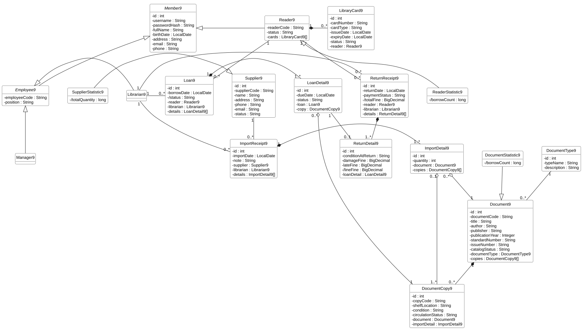

- **Hình 3.2 — Sơ đồ cơ sở dữ liệu** ([Mã nguồn PlantUML](diagrams/src/H3.2-erd-schema.puml), đối chiếu DDL tại [`db/schema.sql`](../db/schema.sql)):

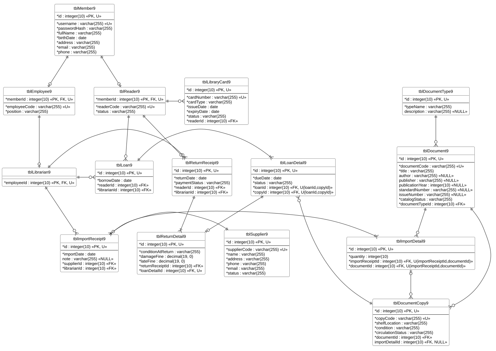

## Đăng nhập và đăng xuất (view/thanhvien)

| Tệp | Trách nhiệm |
|---|---|
| index.jsp | Điều hướng theo `session.member` tới trang chủ vai trò hoặc `view/thanhvien/gdDangNhap.jsp`. |
| view/thanhvien/gdDangNhap.jsp | Form nhập tên đăng nhập (`inTenDangNhap`), mật khẩu (`inMatKhau`), thông báo lỗi nếu sai. |
| view/thanhvien/doDangNhap.jsp | Xác thực qua `MemberDAO.dangNhap` (SHA-256 trên `tblMember9`), tạo phiên mới với `member` và chuyển hướng đúng vai trò. |
| view/thanhvien/doDangXuat.jsp | Hủy phiên hiện tại (`session.invalidate()`) và quay về `gdDangNhap.jsp`. |

## Đăng kí làm thẻ

| Tệp trong view/bandoc | Thành phần của Hình 3.4 | Trách nhiệm |
|---|---|---|
| gdChinh.jsp | dangkythe, bandoc | Hiện tên bạn đọc từ phiên, mở đăng kí. |
| gdDangKyThe.jsp | outMaBanDoc, inoutHoTen, inoutNgaySinh, inoutDiaChi, inoutDienThoai, inoutEmail, inoutLoaiThe, btnThem, btnQuayLai, bandoc | getHoSoBanDoc(id) ở lần mở. Mã chỉ đọc, 5 trường cá nhân được sửa, loại thẻ là select. Thêm gửi form. Quay lại về trang chính. |
| doLuuDangKyThe.jsp | theMoi: LibraryCard9 | Lấy id từ phiên và dữ liệu hồ sơ từ form, gọi dangKyThe. Thành công chuyển tới kết quả, dữ liệu sai/lỗi lưu quay về form giữ giá trị đã gõ, đã có thẻ hiệu lực về trang chính kèm thông báo. |
| gdKetQua.jsp | lblThongBao, lblMaBanDoc, lblSoThe, btnOkay | Hiện thành công, mã bạn đọc và số thẻ thực đã cấp. OK về trang chính. |

`ReaderDAO.getHoSoBanDoc(int): Reader9`; `ReaderDAO.capNhatHoSoBanDoc(Reader9): void`; `LibraryCardDAO.getThe(int): LibraryCard9` (có thể null); `LibraryCardDAO.dangKyThe(Reader9,String): LibraryCard9`. Xem diễn biến từng thông điệp ở TUAN-TU.md.

Khi ghi, khóa tblReader9 theo id. Sau đó getThe xét status và khoảng issueDate ≤ ngày kiểm tra ≤ expiryDate. Cập nhật tblMember9 và thêm thẻ trên cùng Connection. Commit trước khi báo thành công. Giữ các thẻ cũ. Các ngày, trạng thái, số thẻ và readerId không nhận từ form.

### Sơ đồ thiết kế — Đăng kí làm thẻ

- **Hình 3.3 — Giao diện & luồng màn hình** ([Luồng PlantUML](diagrams/src/H3.3-ui-flow-card.puml)):

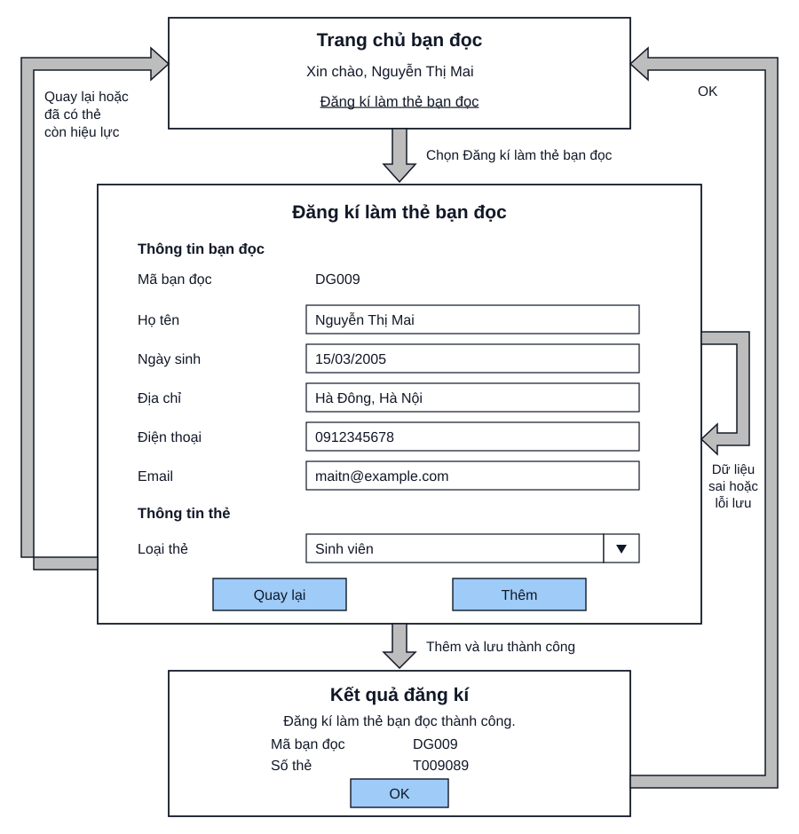

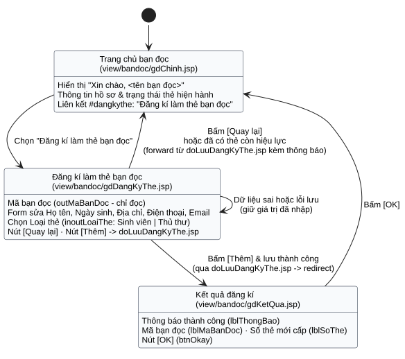

- **Hình 3.4 — Sơ đồ lớp thiết kế Đăng kí làm thẻ** ([Mã nguồn PlantUML](diagrams/src/H3.4-class-card.puml)):

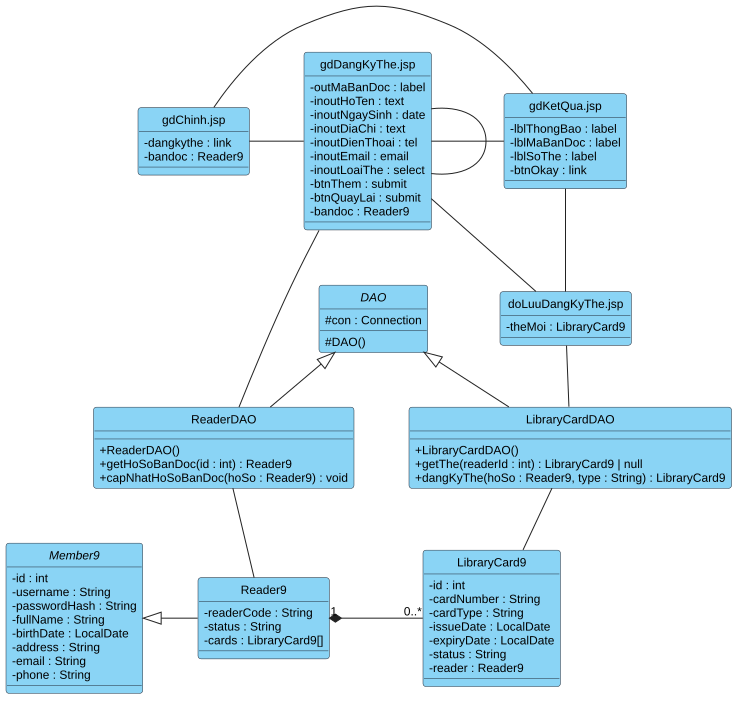

- **Hình 3.5 — Sơ đồ hoạt động Đăng kí làm thẻ** ([Mã nguồn PlantUML](diagrams/src/H3.5-activity-card.puml)):

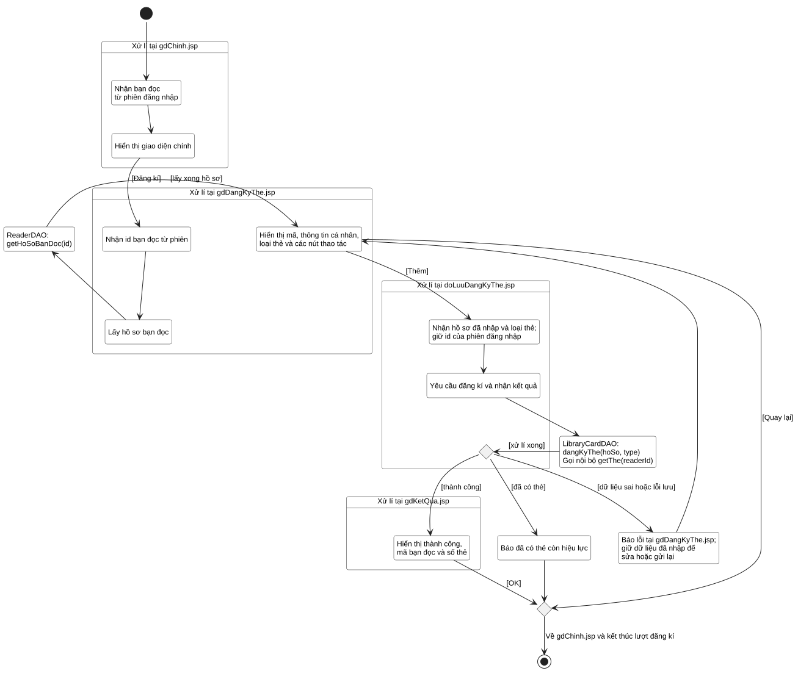

> Xem **Hình 3.6 — Sơ đồ tuần tự Đăng kí làm thẻ** (23 thông điệp) tại [`TUAN-TU.md`](TUAN-TU.md#hình-36--đăng-kí-làm-thẻ).

## Nhận trả tài liệu

| Tệp trong view/thuthu | Thành phần của Hình 3.8 | Trách nhiệm |
|---|---|---|
| gdChinh.jsp | lnkNhanTra, thuthu | Mở nhận trả, tra cứu/in lại phiếu trả theo `idPhieu`, đăng xuất. |
| gdTimBanDoc.jsp | inSothe, inMaBanDoc, btnTim, thuthu | Quét số thẻ hoặc nhập mã (mỗi lần đúng một loại), hoặc mở/in lại phiếu trả theo `idPhieu`. |
| gdDSDangMuon.jsp | outBanDoc, tblDangMuon, chonTra[], btnTiepTuc, btnTimLai, banDoc, dsMuon, thuthu | Xác định hồ sơ rồi lấy dòng OPEN (nạp đủ `loan.details`) và hiển thị các phiếu trả đã lưu gần đây của bạn đọc để đối chiếu/in lại. Checkbox gửi ID dòng mượn. |
| gdChiTietTra.jsp | tblTaiLieuMuon, outNgayTra, inTinhTrang[], inPhatHong[], inPhatCham[], btnLapPhieuTam, btnQuayLai, dsChon, bandoc, thuthu | Hiện người trả, ngày hệ thống và đúng dòng đã chọn. Ô tình trạng mặc định `"Bình thường"` kèm gợi ý (`datalist`). Các input từng dòng dùng hậu tố ID để tránh nhầm thứ tự. |
| doLapPhieuTam.jsp | dsTra: ReturnDetail9[], phieuTam: ReturnReceipt9 | Đối chiếu lựa chọn với phiên, kiểm tra dữ liệu từng dòng, chuẩn hóa tình trạng, tính phạt, lập phiếu tạm mới trong `synchronized (session)` và vô hiệu hóa bản tạm cũ của cùng lượt/bạn đọc. |
| gdPhieuTra.jsp | outBanDoc, outThuThu, outMaPhieu, outNgayTra, tblChiTietTra, outTongPhat, outThanhToan, btnXacNhanTra, btnInPhieu, btnQuayLai, btnTrangChu, phieu | Hiển thị phiếu tạm (chỉ bản `activeDraft` hiện hành), phiếu đã lưu (theo `draft` hoặc nạp trực tiếp từ CSDL theo `idPhieu` cho mọi thủ thư), hoặc liên kết đối chiếu nếu trùng/chưa rõ kết quả. |
| doLuuPhieuTra.jsp | phieuTam, phieuDaLuu | Đồng bộ trên `session`, xác minh `draft` còn là bản hiện hành (chặn bản tạm cũ với HTTP 409), gọi `xacNhanTra`; khi lỗi/xung đột tìm `existingReceiptId` qua `timMaPhieuTheoChiTiet` để đối chiếu. |
| doInPhieuTra.jsp | idPhieu, phieu | Cho phép mọi thủ thư nạp phiếu chính thức theo `idPhieu` độc lập với phiên lập phiếu cũ, chặn in bản tạm chưa lưu (`id == 0`), kiểm tra `PAID`/`NO_FINE` và chuyển về `gdPhieuTra.jsp` kích hoạt in. |

`ReaderDAO.getBanDocTheoSoThe(String)` và `getBanDocTheoMa(String)` trả Reader9 hoặc null. `LoanDetailDAO.getDSDangMuon(int)` trả LoanDetail9[] (đã nạp đủ `loan.details`). `ReturnReceiptDAO.xacNhanTra(ReturnReceipt9)` trả phiếu đã commit. `getPhieuTra(int)`, `getDSPhieuTraTheoBanDoc(int)` và `timMaPhieuTheoChiTiet(ReturnReceipt9)` phục vụ in lại và đối chiếu phiếu chính thức. Phép tính tinhTienPhatDong() và tinhTongPhat() chạy trên thực thể.

Trong xacNhanTra, khóa bản sao và dòng mượn, kiểm tra đúng bạn đọc, còn OPEN và chưa có dòng trả. Tính tổng từ các dòng phía máy chủ. Ghi phần đầu, chi tiết, trạng thái RETURNED và tình trạng/lưu thông bản sao trong cùng giao dịch. Những dòng còn lại tiếp tục OPEN. Lỗi trước commit rollback. Nếu kết quả commit chưa xác định được thì phải đối chiếu giao dịch đã có trước khi thử lại. Cùng lượt trong phiên được đồng bộ hóa khi bấm lặp; ràng buộc UNIQUE của MySQL bảo vệ cả khi các phiên khác nhau cạnh tranh. Lỗi in chỉ nạp lại cùng phiếu.

### Ca nghiệp vụ dùng để nghiệm thu

| Bản sao | Ngày mượn | Hạn trả | Nhận tại quầy | Phạt hỏng | Phạt chậm | Sau xác nhận |
|---|---|---|---|---:|---:|---|
| TL001 · Giáo trình Cơ sở dữ liệu | 01/09/2026 | 20/09/2026 | Bình thường | 0 | 10.000 | RETURNED, có thể lưu thông |
| TL015 · Lập trình hướng đối tượng | 05/09/2026 | 26/09/2026 | Chưa trả | — | — | OPEN, giữ nguyên bản sao |
| TL102 · Tạp chí Công nghệ số 09/2026 | 10/09/2026 | 20/09/2026 | Hỏng | 20.000 | 10.000 | RETURNED, ngừng lưu thông |

Hồ sơ DG009 – Nguyễn Thị Mai; thẻ T009089; thủ thư Trần Thu Hà. Kịch bản gốc cấp thẻ ngày 22/08/2026, trả ngày 22/09/2026. Trước xác nhận, chưa có phiếu chính thức. Thủ thư thu 40.000 đồng và bấm một lần. Kết quả gồm một phiếu PAID, hai dòng trả; in lại cùng mã phiếu. Chạy một trường hợp khác với tổng bằng 0 để kiểm tra NO_FINE.

### Sơ đồ thiết kế — Nhận trả tài liệu

- **Hình 3.7a & 3.7b — Giao diện & luồng màn hình** ([Luồng PlantUML](diagrams/src/H3.7-ui-flow-return.puml)):

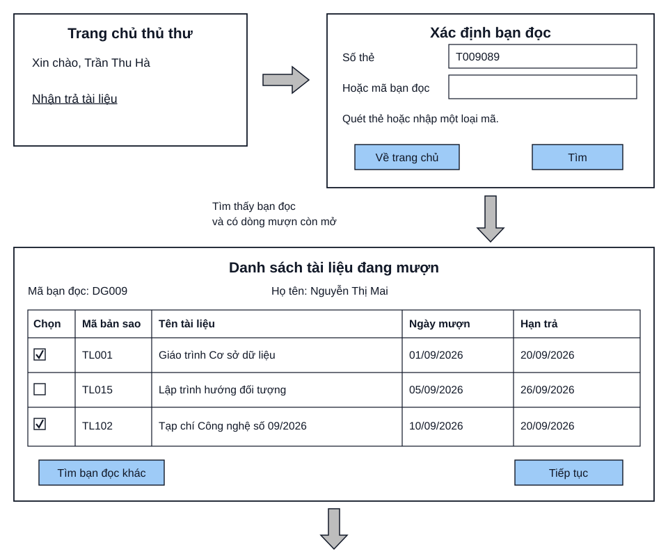

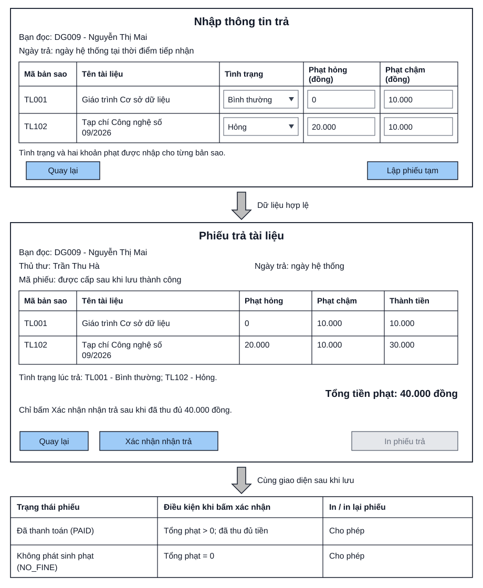

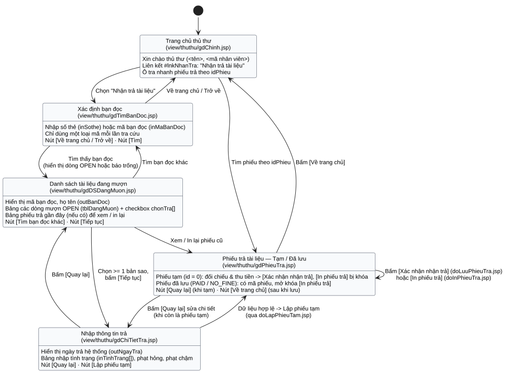

- **Hình 3.8 — Sơ đồ lớp thiết kế Nhận trả tài liệu** ([Mã nguồn PlantUML](diagrams/src/H3.8-class-return.puml)):

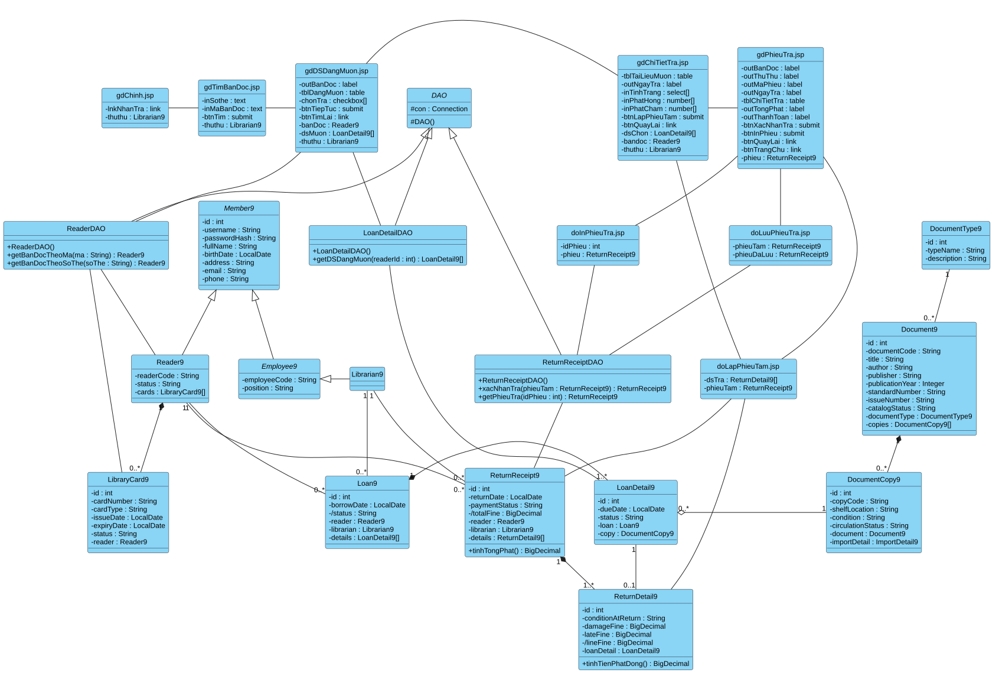

- **Hình 3.9 — Sơ đồ hoạt động Nhận trả tài liệu** ([Mã nguồn PlantUML](diagrams/src/H3.9-activity-return.puml)):

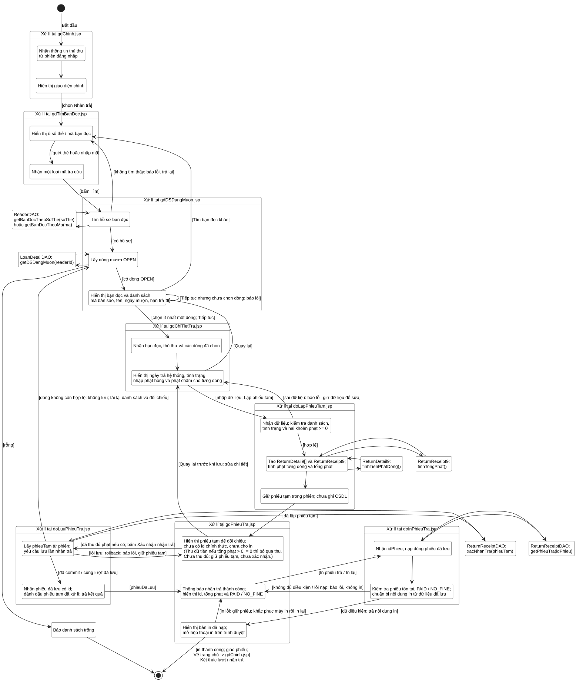

> Xem **Hình 3.10 — Sơ đồ tuần tự Nhận trả tài liệu** (54 thông điệp) tại [`TUAN-TU.md`](TUAN-TU.md#hình-310--nhận-trả-tài-liệu).

## Những quyết định và chính sách đã chốt

- **Loại thẻ và thời hạn thẻ:** Hệ thống dùng 2 loại thẻ chính là `Sinh viên` và `Thủ thư` (`LibraryCardDAO.VALID_CARD_TYPES`), thời hạn cố định mặc định là `12` tháng (`LibraryCardDAO.DEFAULT_CARD_MONTHS = 12`). Có thể ghi đè số tháng qua biến môi trường `LIBMAN_STUDENT_CARD_MONTHS` nếu cần. Ngày hết hạn bằng ngày cấp cộng số tháng, ngày cuối vẫn còn hiệu lực.
- **Thuật toán cấp số thẻ:** Dùng chữ `T` và `id` tự tăng đệm ít nhất 6 chữ số (`T%06d`, ví dụ `T009089`). DAO dùng UUID giữ chỗ duy nhất trong giao dịch rồi cập nhật số thẻ chính thức trước commit.
- **Bộ mã trạng thái và chuẩn hóa tình trạng bản sao lúc trả:**
  - Các trạng thái cố định: `OPEN`, `RETURNED` (dòng mượn); `CLOSED` (`Loan9.getStatus()` khi tất cả dòng đã `RETURNED`; ném `IllegalStateException` nếu `details` chưa nạp); `PAID`, `NO_FINE` (phiếu trả); `ACTIVE` (thẻ/bạn đọc/tài liệu); `AVAILABLE`, `UNAVAILABLE`, `ON_LOAN` (lưu thông bản sao); `LIBRARIAN`, `MANAGER` (vai trò nhân viên).
  - Tình trạng lúc trả mặc định là `"Bình thường"`. Chuỗi nhập vào được `ReturnReceiptDAO.chuanHoaTinhTrang` cắt khoảng trắng đầu/cuối, gộp khoảng trắng thừa và chuẩn hóa cách viết hoa/thường của `"Bình thường"`.
  - `ReturnReceiptDAO.xacDinhTrangThaiLuuThong`: bản sao giữ `"AVAILABLE"` mặc định và **chỉ chuyển sang `"UNAVAILABLE"`** khi tiền phạt hỏng `damageFine > 0` **hoặc** mô tả tình trạng chứa từ khóa hư hại/mất/ngừng lưu thông (`hỏng`, `hong`, `mất`, `mat`, `rách`, `rach`, `ướt`, `uot`, `bẩn`, `ban`, `thiếu`, `thieu`, `hư`, `ngừng`, `không bình thường`, `khong binh thuong`, `cần sửa`, `bảo trì`, không phân biệt hoa/thường). Tiền phạt do thủ thư nhập từng khoản.
- **Phiên bản phiếu tạm và đồng bộ hóa:** Mỗi lượt nhận trả (`selection`) và mỗi bạn đọc trong phiên chỉ có tối đa một `draft` hiện hành (`activeDraft.<selection>`, `activeReaderDraft.<readerId>`). Khi lập phiếu tạm mới trong `doLapPhieuTam.jsp`, bản tạm cũ bị xóa khỏi phiên; `doLuuPhieuTra.jsp` đồng bộ trên `session`, kiểm tra phiên bản hiện hành và từ chối bản cũ với HTTP 409.
- **Kiểm tra dữ liệu và bảo mật phiên:** Điện thoại dùng 8–15 chữ số với dấu `+` tùy chọn; email kiểm tra định dạng cơ bản. Mật khẩu trong `tblMember9.passwordHash` dùng SHA-256 hex (`MemberDAO.bamMatKhau`). Các mã `lookup`, `selection`, `draft` và `csrf` phục vụ trao đổi an toàn trong phiên, không tạo cột nghiệp vụ.
- **Phạm vi mở rộng:** Các gói chính và thư mục `view/thanhvien`, `view/bandoc`, `view/thuthu` có mã thực thi; phần thống kê nằm ở `view/quanli`. Khi triển khai các luồng còn lại, cần kiểm tra loại hồ sơ và `position` trong giao dịch tạo tài khoản, khóa bản sao trước khi cho mượn, kiểm tra số lượng và `documentId` khi nhập. Chi tiết nhập tài liệu, quản lí danh mục, tra cứu và thống kê nằm ngoài hai modul thiết kế chi tiết; bảo toàn lịch sử khi ngừng sử dụng các đối tượng đã phát sinh giao dịch.

## Kiến trúc triển khai, gói và cấu trúc thư mục

- **Hình 3.11 — Sơ đồ triển khai** ([Mã nguồn PlantUML](diagrams/src/H3.11-deployment.puml)):

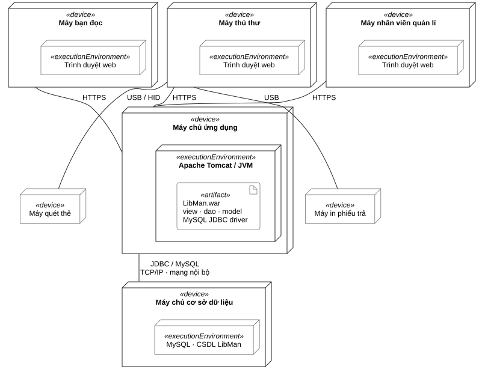

- **Hình 3.12 — Sơ đồ gói** ([Mã nguồn PlantUML](diagrams/src/H3.12-package.puml)):

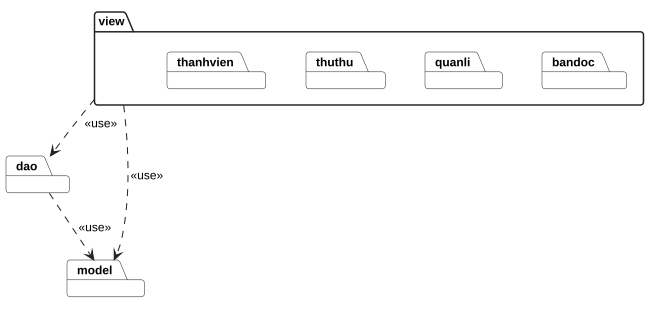

- **Cấu trúc thư mục dự án** (dạng Maven WAR; trong Eclipse, `src/main/java` tương ứng *Java Resources* và `src/main/webapp` tương ứng *WebContent*):

```text
LibMan/
├── .github/workflows/render-diagrams.yml
├── db/
│   ├── scenario-test.sql
│   └── schema.sql
├── spec/
│   ├── diagrams/
│   │   ├── src/                    # Nguồn PlantUML (H3.1–H3.12 + _theme.puml)
│   │   └── svg/                    # Ảnh SVG render từ PlantUML & wireframe UI
│   ├── NGOAI-LE.md
│   ├── SPEC.md
│   └── TUAN-TU.md
├── src/
│   ├── main/
│   │   ├── java/
│   │   │   ├── dao/                # DAO, LibraryCardDAO, LoanDetailDAO, MemberDAO, ReaderDAO, ReturnReceiptDAO
│   │   │   └── model/              # 19 JavaBean thực thể và thống kê (*9.java)
│   │   └── webapp/                 # Tương ứng WebContent trên Eclipse
│   │       ├── assets/             # css/libman.css, js/libman.js
│   │       ├── view/               # bandoc/ (4 JSP), thanhvien/ (4 JSP), thuthu/ (8 JSP)
│   │       ├── WEB-INF/            # 7 *.jspf dùng chung + web.xml
│   │       └── index.jsp
│   └── test/java/                  # MySqlScenario.java, ReportExample.java
├── mvnw / mvnw.cmd
├── pom.xml
├── README.md
└── run.ps1
```

- **Biên dịch lại SVG từ mã nguồn PlantUML** (khi chỉnh sửa [`diagrams/src/*.puml`](diagrams/src/)):

```powershell
java -jar plantuml.jar -charset UTF-8 -tsvg -o spec/diagrams/svg spec/diagrams/src/H*.puml
```
